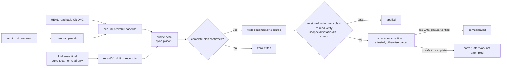

# 架构概览

## 总体设计

Agent Config Bridge 采用声明式单一源树：共享配置以 Claude 形态落在项目里，其他
host-native carrier 是投射。源形态是容器 schema 的工程选择，不表示 Claude 优先；
用户可以从 Claude Code 或 Codex 会话提出变更，projection-side 新意图经证据充分的
adoption 回到 source，再投射到两侧。

架构受三条原则约束：

- **AI-native**：工作流、语义判断与用户采访由 skill + LLM 承担；文件操作使用 host
  自带工具；自定义代码只做 byte compare、path/type check 等稳定机械步骤。
- **Git-native**：tracked tree 是可证明事实，reachable history 是 arbitration /
  ownership evidence；不建长期 daemon、内容 hash 数据库或独立同步 baseline。
- **权限分层**：只读观察与写侧 reconciliation 是两个 skill；current carrier diff
  不授予写入方向。

详细状态机见[同步模型](../implementation/sync-model.md)。



## 源树与 milestone 边界

完整 MVP 的逻辑布局是：

```text
<project-root>/
  CLAUDE.md
  .claude/
    rules/*.md
    rules/hooks.md
    skills/<name>/
    settings.json
  AGENTS.md
  .agents/skills/<name>/
  .codex/hooks.json
```

实现按风险分阶段开放：

- **M2**：开放技能 complete Git tree，并用 v1 covenant bootstrap。
- **M3**：升级到单一当前 tuple，开放 entry / rule shards 到 `AGENTS.md` managed
  blocks 的投射与反向采纳。
- **M4**：才开放 hook intents 到双侧 hooks carrier。

M3 仍不安装 `hook-intents.md`、不写 hooks；CLI、package、plugin manifest 与
distribution payload 也继续受 M5 门禁。

## 为什么 source 是现有树

source 是项目中现有 Claude 形态树的角色，不新增中立顶层目录：

- Claude 原生消费一侧，技能只需向 Codex 做一跳 byte projection；
- 两 host 都使用 `SKILL.md` 技能目录，技能可先验证最窄的 native carrier；
- M3 的 `.claude/rules/` 提供分片与 path scope 的超集容器，Codex 通过
  `AGENTS.md` 受管区块降级表达；
- Codex 起点项目仍可经明确 annex / onboarding 进入同一模型。

source 同时是 Claude runtime input，因此必须保持对 Claude 无害或有益。Codex
approval / sandbox 等 runtime execution policy 不进入共享 source，避免把散文提示
伪装成安全边界。

## versioned covenant

M3 用 tracked、immutable、双 half 的 `covenant/v2` 建立项目级 onboarding anchor：

- `.claude/rules/bridge-covenant.md` exact source template；
- root `AGENTS.md` 内 exact managed block，区块外是逐字节保留的 manual zone。

两个 half 绑定 `source-tree/v4`、`report/v4`、`reconciliation/v2` 与
`sync-plan/v2`。二者必须同时 tracked、schema / template / version valid 才算
onboarded。partial / malformed / untracked / modified / mismatch 是 blocker；旧版本
进入显式 migration，不能当普通 drift。历史上曾完整 onboard、当前 pair 消失是
offboarding decision。判定优先级是 safety / trackability、pair coherence、tuple
version、history；因此 untracked old tuple 先 `repair` / 用户处理，形成 tracked
exact pair 后才可在新一轮进入 `migrate`。

covenant 只声明 ownership model，不会把项目里所有 `.agents/skills/<name>/`
自动据为己有。unit ownership 仍需 Git transition evidence 或本轮明确 annex。
写侧把 partial / modified pair 作为 `repair`，历史消失作为明确 `restore` /
`offboard`，tuple barrier 作为 `migrate`；v1/v3 exact bytes 只供一次性显式
migration 识别，运行时不保留双读。每个动作都以两个 half 与 manual zone
为同一 closure。Bridge 不 stage，所以新建 half 在用户自行记录前不能虚报
onboarded。

迁移不是只替换两个 covenant bytes。写侧先从 reachable v1 DAG 推导完整 legacy
owned set，并在独立 Migration candidates table 按 unit 列出全部
ancestry-maximal OID。唯一候选才形成标量 legacy baseline；多个不可比候选保持
`ambiguous` 并阻断，不能任选一个。当前满足 v4 relation 的唯一候选 unit 必须自动
carry；缺失、不安全或未收敛的 unit 也必须进入闭集决策。最终由一个 reachable Git
transition commit 同时承载 v2/v4 covenant 与闭合 carried set，该 commit 才为这些
unit 建立 current baseline。Bridge 不 commit，因此只有 worktree bytes 而没有该
transition 时仍是 migration pending；runtime 始终只读 v2/v4。

## 两层状态：carrier 与 reconciliation

### Sentinel：current carrier

Sentinel 对当前 repo bytes 做只读观察：

- skill paths、bytes 与 modes 是否相同；
- entry/rule managed block 与未来 hook carrier 的当前结构状态；
- path safety、loadability 与 portability lint；
- onboarding covenant 是否完整。

Codex activation 另有独立 live-input 域：resolved root markers、fallback names、
document budget，以及 root override / AGENTS / fallback 的 exact safe-file evidence。
这些 carrier 即使 untracked / ignored 也要检查，但其 bytes 只用于 loadability /
shadow / budget，绝不进入 ownership 或 baseline；配置或 carrier 无法确定时默认阻断。

它可以记录 additions-only / deletions-only / both 作为 evidence，但所有 onboarded
且 source 存在的 drift，suggested action 都是 `reconcile`。copy-only S4 在两种
onboarding 状态下都保持 `adoption-candidate` / `annex-or-keep`，因为只有 Sync
历史仲裁才能区分 unmanaged copy 与受管 source deletion。`adopt`、`reproject` 与
`conflict` 不在 Sentinel 权限内。

### Sync：Git baseline reconciliation

Bridge Sync 为每个 unit 从 `HEAD` 可达 DAG 重算 candidate baselines。candidate
必须在当前 contract 下 ownership 有效。技能 candidate 要求 source / projection
complete Git tree 在 path、type、raw bytes、mode 上一致；entry/rules candidate
保存 raw source 与其 deterministic rendered block pair，不要求 carrier bytes
同形。取 ancestry-maximal candidate：

- 唯一 maximal → baseline；
- 零个 → evidence insufficient / no baseline；
- 多个互不比较 maximal → merge ambiguity，停问。

算法不按 timestamp 或 first-parent 擅选。随后才用同一 baseline 区分
source-only、projection-only 与 both-changed。只有两侧自同一 baseline 得到不同
current trees 才是 conflict；Bridge 不自动三方 merge。

## canonical units

技能 unit 是 immediate `.claude/skills/<name>/` 的完整 regular-file Git tree，
projection 是 `.agents/skills/<name>/` 的同名完整 tree。契约包括：

- `SKILL.md`、required `bridge-intent.yaml` 与全部 scripts / refs / assets；
- source 明确提供的 `agents/openai.yaml` 逐字节复制；
- relative file set、blob bytes 与可保真的 Git mode；
- empty directories 不存在于 Git tree。

不派生 sidecar、不写 `skills.config`。symlink / gitlink / reparse / special file /
case collision / path escape 阻断。tree identity 用 manifest 比较 path、type、
bytes、mode：tracked current 组合 HEAD / index 与可用的 POSIX worktree mode
probe，历史读 Git tree；probe 不可用时普通 untracked 使用 prospective default
`100644`。只有方向性写入或 explicit intent 要求 target 实现无法可靠设置的 mode
时才产生 `mode-limited`；零写 pending / keep 不受影响。filesystem-only content
equality 不是 tree equality。

M3 的 entry/rules unit 不要求 source 与 carrier bytes 同形：

- `entry` 只在 `CLAUDE.md` 与 `.claude/CLAUDE.md` 恰好存在一个时成立；二者并存
  没有默认胜者，直接阻断；
- rule unit 是 `.claude/rules/**/*.md` 分片，排除 immutable covenant 与
  `hooks.md`；
- source raw bytes 经 `source-tree/v4` 固定 render 生成一个 root `AGENTS.md`
  block；baseline 是 `(raw source, rendered block)`，而不是二树 byte equality；
- `paths` 使用严格可逆 `pv2` applicability preamble，invalid、no-op、duplicate 或
  brace expansion 超出 1,000 patterns / 4 MiB 的分片直接阻断，绝不扩大为
  unscoped；
- active shared `@path` import 一律阻断；code span / fence 与 claude-only 区段内
  的 inert 文本除外。shared prose 先写成 host-neutral，Claude-only 用受控注释
  减除，Codex-only 留在 manual zone。

entry/rule intent 采用受控 HTML comment，不把 Bridge 私有键写进 Claude 只文档化
`paths` 的 YAML frontmatter。自由 semantic managed mode 被删除：歧义 reverse
adoption 必须展示 source candidate 与确定性 rerender 后取得明确确认。

## compatibility 是四条正交轴

投射 mechanism tier 与行为兼容不能混成一个布尔值：

| 轴 | 回答的问题 |
|---|---|
| Agent Skills format | `SKILL.md` 是否满足公共格式与 identity contract |
| runtime loadable | 两个 host 是否确定可加载当前 bytes |
| release validator profile | 当前某版 authoring validator 是否接受 |
| behavior portability | host extension / dynamic rendering / permissions 是否同义 |

技能 complete-tree copy 的 carrier tier 是 `native`。Claude-only frontmatter、
dynamic body 与 `allowed-tools` 若两 host 仍可加载，就原样复制并标
`behavior-degraded`；identity、YAML、确定加载失败与 path safety 才 blocker。
validator rejection 单独报告，不反向改写合法 source。

Codex 项目 skills 没有已文档化的 project-trust gate，所以不用
`awaiting-host-trust`。repo bytes 也不能证明当前 session 已重新发现 skill，故使用
中性的 `live-activation-unknown` 与 restart hedge。hooks 的 trust annotation 是
另一条未来 surface 事实，不能外推到 skills。

## ownership 与写入护栏

ownership 分三种粒度：

- 技能：完整 file set / Git tree；
- M3 的 `AGENTS.md`：managed block，manual zone 不受管；
- M4 的 hooks：intent 声明的 keys。

M3 任何写入都遵循：

1. relevant tracked、non-ignored untracked、ignored 与 dirty scope 全部进入计划；
2. ignored / secret / generated payload 不复制，Bridge 不 stage / commit；
3. 无 baseline 的 non-empty target 必须 annex-or-keep，零静默覆盖；
4. delete / rename 只有 Git 证明目标曾受管才可自动进入计划；
5. 每次写前给完整 scoped plan 并确认；conflict / annex / replace / migrate /
   offboard / destructive decision 需明确选择；
6. decision 按 unit，execution 按稳定 closure id 聚合；selection、dependency 与
   per-closure authorization 必须序列化进 plan，未选择项不能藏在 prose；
7. Write capabilities 按执行顺序记录每条 path 的 forward / inverse protocol；
   migration 另列全部 maximal candidate OID；
8. 首次写前 journal 绑定 operation id、repo / HEAD、confirmed plan digest、closure
   ids、capability binding 与每条 path 的 exact pre/post value；
9. 写后重读、机械比较、scoped status / diff / diff --check。

`AGENTS.md` 是共享物理文件但不是整文件 ownership：Bridge 把所有被选 block 变更
一次合成 desired image，manual spans、未选择 block 与 conflict block 原字节参加
完整 pre/post image。已证明 `strict-replace/v1` 时使用严格替换；否则 eligible
现有文本文件可用明确非 CAS 的 `guarded-patch/v1`：完整 preflight、一次唯一
exact-region replacement、完整 postverify。新文件只用 `strict-create/v1`。
root override、root marker 无法证明、fallback shadow、budget=0、planned bytes
超限或没有合格 write protocol 时都阻断；Bridge 不修改 Codex config 来规避宿主
加载事实。详见[写入协议 ADR](write-protocol.md)。

`keep` 只表示本轮零写且未解决，不创建 ignore manifest、不能报同步成功。conflict
unit 与其 closure 零写；确认后可执行互不依赖的无歧义 closure。

## intent 与可追溯性

每个 managed skill 有 `bridge-intent.yaml`。create / annex / adopt / semantic
change / rename 追加日期与动机；pure mechanical reproject 不追加。intent 是
arbitration evidence，不授予 ownership、不覆盖 baseline。

entry / rule 使用严格 `bridge:intent` HTML control comments；render 会剥离这些
Bridge 元数据。Codex 起点 onboarding 将既有 `AGENTS.md` 按 exact spans 列出
`shared-entry` / `shared-rule` / `manual` / destructive `discard` 选择，逐段确认，
禁止整文件隐式 annex。

Bridge 不自动 commit。delete 的 tombstone 动机需由后续 user commit / diff evidence
承载；rename 在 new source intent 中记录 old/new。版本 migration 与 offboarding
同样必须在计划与后续 Git history 中可解释。

## failure、rollback 与 git 边界

写入按 path 选择版本化协议。strict replace/create/delete 只有 capability adapter
绑定 host/version/platform/filesystem 并证明完整条件语义时才可用。现有安全文本
替换可选择 `guarded-patch/v1`，但必须披露 residual race；preflight/postverify
只能过滤与发现 stale value，不能冒充 CAS。create、delete、rename、mode change
与 compensation 不得 guarded 降级。协议保证止于 host operation 与底层
filesystem，Bridge 不自建锁、跨文件事务或 crash durability。

journal 只服务同一 live operation：它绑定 opaque operation id、resolved repo、
starting HEAD、exact confirmed plan digest、selected closure ids、每步 protocol、
pre/applied value 与 lifecycle。失败补偿默认 unavailable；只有所有 inverse step
在首写前都证明为 strict 且 journal 仍由当前 operation 持有时才逆序执行。否则不做
optimistic reverse，直接按观察结果报 `partial`，后续项报 `not-attempted`。禁止
扫描临时目录寻找旧 journal。

一旦结果是 `applied`，journal 即关闭，不授予事后或跨 session rollback。后续 rollback
必须从 current bytes + reachable Git 重建新计划并重新确认；用户确认不能用任意
evidence 替代 ownership、baseline 或 prior bytes。Git 无法重建旧值时明确不可回滚，
只能另行按正常门禁计划 annex 或 destructive decision。绝不 blanket restore /
reset / stash，也不擦除用户原有或并发 dirty bytes。

entry/rule closure 在首写前预计算完整 `AGENTS.md` image 并重验全部 source 与
full preimages；canonical source 先写，Codex carrier 最后写。journal 同时保存
完整 AGENTS preimage / applied image 与 guarded region，使失败分类不依赖重解析
某个局部区块。

Git 的作用是事实与损失边界，不是 Bridge 获得无限写权限的理由。

## 仓库与分发

开发态 skill、templates、knowledge 与 fixtures 和未来 plugin boundary 同仓库存放，
但 packaging 仍由 milestone gate 控制。目录职责与 Claude / Codex 入口差异见
[分发模型](../implementation/distribution-model.md)。
