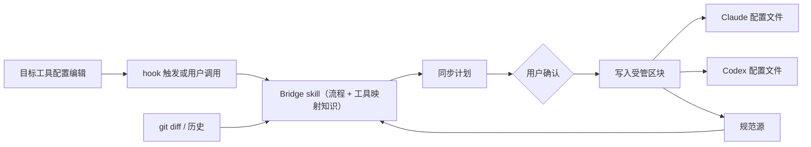

# 架构概览

## 总体设计

Agent Config Bridge 使用单一规范源模型：项目中保留一份长期维护的配置，Claude Code 和
Codex 看到的是从这份配置投射出来的目标工具配置文件。

Bridge 采用按需触发的交付形式：一组面向目标工具中智能体的 skill 和一份工具映射知识库。
skill 负责规定读取、判断、出计划和写入的流程；映射知识库说明同一个规范条目在
Claude Code 与 Codex 中应该如何表达，以及哪些能力只能部分表达或无法表达。

确定性部分交给 git。`git diff` 用来确认本次改动，git 历史用来定位上次同步基线，
`git restore` 用来回滚错误写入。Bridge 不维护额外的内容指纹或归因数据库。

这里的“双向”由两条受控路径组成：

- 投射：从规范源生成 Claude Code / Codex 配置文件。
- 对账：检测目标工具配置文件中的漂移，在用户确认后把可采纳修改写回规范源。



## 为什么需要规范源

直接把 `CLAUDE.md` 或 `AGENTS.md` 当作唯一来源会丢失信息。目标工具配置文件是面向该工具的
渲染结果，不适合作为另一工具配置的完整来源：

- 钩子这类配置表达的是执行意图；同名能力在两个工具中可能对应不同生命周期点。
- Codex 的命令审批 / 沙盒规则、Claude Code 的项目规则和技能入口都带有工具特定语义。
- 发生冲突时需要一个不属于任一工具的判断锚点，git 负责给出差异，规范源负责承载意图。

因此规范源只承担三项职责：

1. 保存工具无关的配置意图。
2. 放置各工具特化的补充内容。
3. 为冲突判断提供中立基线。

不同配置面的规范源厚度不同。技能接近可复制母本；规则和钩子更依赖规范源来保存意图和
工具差异。展开见[同步模型](../implementation/sync-model.md)。

## 规范源布局

规范源位于使用 Bridge 的项目中；Bridge 自身仓库只提供 skill、映射知识和包装脚本。
推荐使用一个可见、工具中立的顶层目录：

```text
<project-root>/
  agent-config/             # 规范源：项目长期维护的位置
    skills/<name>/SKILL.md  # 投射到各工具技能目录的母本
    rules/overview.md       # frontmatter 声明 targets / tool 策略
    rules/workflow.codex.md # 工具特化 delta，就近共置
    hooks/pre-commit.md     # 意图级：触发点 / 目的 / 命令 / 失败策略
  CLAUDE.md  AGENTS.md       # 人工段落 + 受管区块（投射自 rules/*）
  .claude/  .codex/          # 投射目标：skills、rules 片段、settings 等
```

主要取舍如下：

- **工具中立**：规范源不放在 `.claude/` 或 `.codex/` 内，避免物理位置暗示某个工具拥有
  最终解释权。
- **可见目录**：规范源是用户主动维护的位置；`.claude/`、`.codex/` 等 dotfile 目录则更
  接近目标工具运行态配置。偏好干净根目录的项目可以改用 `.agent-config/`，不影响模型。
- **按域组织，delta 就近**：`skills/`、`rules/`、`hooks/` 对齐三类配置面；工具特化
  内容用 `<name>.<tool>.md` 命名，放在母本旁边；每个条目的投射策略写在 frontmatter。

命名取 `agent-config/` 是为了表达内容角色，避免与某个目标工具概念绑定。投射目标
`CLAUDE.md`、`AGENTS.md`、`.claude/` 等保持入 git，因为它们既是目标工具实际读取的配置，
也是漂移判断和回滚的依据。

## 系统分层

架构分成六层：

- **规范存储**：保存项目级智能体配置，包括技能、规则和钩子的工具无关描述。格式采用
  markdown、轻量 frontmatter 和目录约定，便于人工审阅和目标工具中的智能体直接处理。
- **工具映射知识**：记录 Claude Code / Codex 的语义差异，标注每个规范条目是 `full`、
  `partial` 还是 `unsupported`。已确定的映射沉淀为枚举表由代码查询，尚未确认的长尾交给
  LLM 判断；这份知识带采集日期，随工具演进更新。
- **目标工具自带工具**：读写文件由目标工具的 Read / Edit / Write 承担，受管区块的
  “区块外逐字节保留”由精确匹配保证，不另写文件读写器。
- **Bridge skill**：编排上面几者——默认借助 LLM 和目标工具的固有能力，只把逐字节比对、
  已确定映射查表等过窄门的操作交给代码。它读取规范源、映射知识和 git 状态，生成同步
  计划，确认后写入受管区块。
- **git 底座**：提供 diff、历史基线和回滚能力。归属信息由 git 历史与受管区块标记共同
  承担。
- **打包与入口层**：把 skill、映射知识和包装脚本发布成 Claude Code / Codex 可用的
  插件。入口负责定位自带文件并启动相应流程。

这个分层把“如何判断工具语义”与“如何可追溯地写文件”分开处理。前者由映射知识和 skill
流程约束，后者由目标工具自带工具、受管区块和 git 保证可审阅、可回滚。

## 投射流程

投射是常规路径：从规范源生成 Claude Code 和 Codex 的目标工具配置文件。一次投射大致包括：

1. hook 触发或用户调用 skill，并给出相关文件和目标工具上下文。
2. skill 使用 `git diff` / `git status` 读取实际变更。
3. 对照规范源和工具映射知识，为每个目标判断 `create`、`update`、`unchanged`、
   `conflict` 或 `unsupported`。
4. 输出同步计划。用户确认后，只写入 Bridge 受管的文件和区块。

触发信号提供“谁发生了变化”的上下文；受管区块和 git 历史提供“哪些内容属于 Bridge”的
判断依据。

## 对账流程

对账处理非正常触发路径，例如用户直接编辑目标工具配置文件、改动来自 `git pull`、插件安装
前已经存在配置，或上一次投射中断。

对账由用户按需调用 reconcile skill。skill 读取两个工具当前内容、规范源，以及 git 历史
中的上次同步基线，报告漂移并给出合并建议。是否把某次目标工具中的修改采纳回规范源，
由用户确认。

如果规范源和目标工具配置文件相对上次同步态同时变化，则报告 `conflict`。这类冲突不自动合并，
以免把工具渲染结果误当作长期意图。

## 护栏

写入由 skill 流程约束，必须满足以下规则：

- 只改 Bridge 受管的文件集合。
- 文件中只修改受管区块，区块外内容逐字节保留。
- 遇到没有受管标记、看起来由用户手写的目标工具配置文件，先询问采纳还是替换。
- 无法判断语义等价性时停止并要求用户确认。
- 写入前展示同步计划，写入后通过 git diff 和重读文件进行自检。

这些护栏把写入限制在可审阅、可撤销的流程内，也限制了目标工具中的智能体需要自行判断的范围。

## 目标工具边界

初始设计只处理项目级目标：

- Claude Code：技能、项目说明、规则，以及 `hooks` / `settings` 中可表达的项目级事件。
- Codex：技能、项目指令、语义等价的规则，以及当前公开机制能表达的自动化
  （automation）/ 类钩子配置。

工具映射知识必须如实暴露工具差异。映射策略按语义保真度分级：完整映射标 `full`，只能
表达一部分标 `partial`，缺少等价承载面的标 `unsupported`。提示词引导、命令审批规则、
权限和执行时机按各自语义处理；同步计划里的“已同步”必须建立在这些语义可解释的基础上。

## 仓库和生成物

本仓库采用单仓库模式：上游开发态内容（skill 源、工具映射知识、薄包装脚本源、文档、
测试）和可安装插件产物共存。产物以 skill 和知识为主，代码面保持小。

生成物分两层：`dist/` 是包装脚本的构建中间产物，不入库；`plugin/` 是可安装的插件产物，
作为入库的边界产物提交，但仍按生成物管理。

README 和智能体指引需要写清楚：`plugin/` 内容由上游组装，不接受手工修改；要改变行为，
应修改上游 skill、映射知识或包装脚本，再重新组装。分层细节见
[../implementation/distribution-model.md](../implementation/distribution-model.md)。
