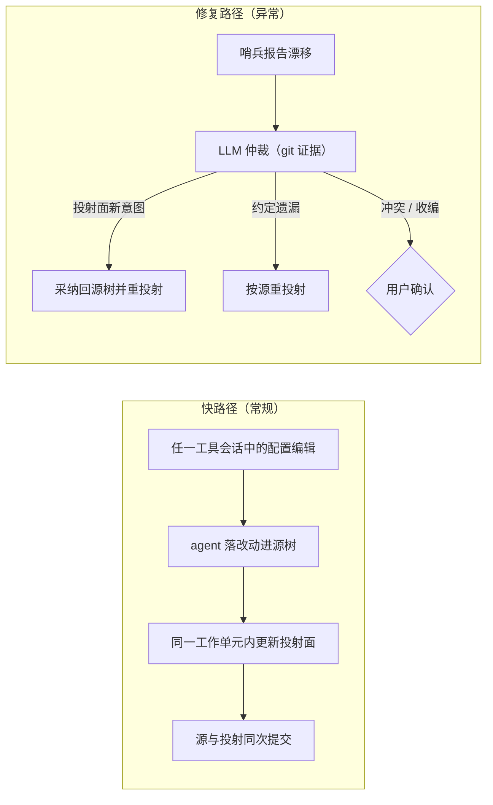

# 架构概览

## 总体设计

Agent Config Bridge 使用声明式单一源树模型：项目中一棵 Claude 形态的配置树被声明为
唯一源（下称源树），其余所有 host 可见的配置都是从源树投射出来的结果
（清单见下文"源树与投射面"）。

两点前提约束全部设计：

- **工具等权重**：本项目假设用户在各工具之间等权重切换，没有主次工具。源树取
  Claude 形态只是容器 schema 的工程选择（结构超集，且被一个 host 原生消费），不代表
  Claude 用户优先；编辑体验必须对称——用户在任一工具的会话里都能表达配置意图。
- **AI-native**：同步能力主要由 skill 承载，语义判断交给 LLM，文件读写交给 host
  自带工具，确定性兜底交给 git，不建同步引擎。

同步因此不是"两份状态之间的对账"，而是一组行为约定加两级兜底：

- **快路径（编辑即传播）**：任一工具会话中产生配置意图时，执行编辑的 agent 按约定
  把改动落进源树，并在同一个工作单元内更新投射面。同步单元就是一次提交：源与投射
  一起入 git，常规路径上不存在跨提交漂移。
- **哨兵（漂移检测）**：便宜的确定性检查，发现投射面与源树不一致（约定被违反、
  用户手改投射面、`git pull` 带入外部改动）时报告，不自行修复。
- **仲裁（语义修复）**：漂移确认后，由 LLM 结合 `git log` / `git blame` 证据判断
  改动的归属与去向：投射面上的新意图自动采纳回源树并重投射，约定遗漏直接按源
  重投射；只有冲突与收编决策需要用户确认。

编辑入口是对称的：源树是唯一真相，但不是唯一可编辑的位置。人工或 agent 直接改
了投射面（例如手改 `AGENTS.md`，哪怕改的是来自规则分片的段落），改动会被反向
采纳回源树的对应位置（入口或分片），再重投射到所有面。`CLAUDE.md` 与
`AGENTS.md` 因此都不需要人工双份维护。



确定性部分交给 git：`git diff` 确认改动，提交历史充当仲裁证据，`git restore` 回滚
错误写入。Bridge 不维护内容指纹、归因数据库或独立基线快照。行为约定是概率性的
（agent 可能忘记收尾），但失败的最坏结果只是暂时漂移，可由哨兵发现、仲裁修复、
git 回滚——失败代价被 git 封顶。

## 为什么源是一棵现有的树

"源"是对项目中现有配置树的角色声明，而不是一个独立的中立源目录。理由有三：

- **零新增布局**：源就是 `CLAUDE.md` 加 `.claude/`，项目根目录不多一个顶层概念，
  用户不用学习一套既非 Claude 也非 Codex 的第三种格式。
- **一个 host 免费**：Claude Code 原生消费源树，投射只需覆盖其余 host；改动也
  只走"源到投射"一跳，不存在"源与两个投射"的三方同步。
- **中间 schema**：源树布局对本项目而言只是承载共享语义的容器。Codex 起点的项目
  同样由 skill 引导，把既有 `AGENTS.md` 内容收编进源树（见
  [同步模型](../implementation/sync-model.md)的项目引导一节）。

选 Claude 形态当超集容器的结构理由：`.claude/rules/` 支持多文件分片、递归发现和
path-scoped frontmatter；技能目录以 `SKILL.md` 为核心，两个工具都能消费；hooks
在两侧都有真实的配置面。结构差异集中在指令组织：Codex 没有 `.claude/rules/`
那样的多文件分片机制，`AGENTS.md` 承载不了分片组织与 path-scoped 作用域，
反向不成立。

源树身兼双重角色：它同时是 Claude 的运行态配置，因此源树内容必须满足"被 Claude
读取时无害或有益"。钩子意图文档以规则片段的形式存在（Claude 读到的是意图说明，
正好有益）；Codex 审批 / 沙盒这类执行语义不进源树，声明为 Codex 所有。

## 源树与投射面

```text
<project-root>/
  CLAUDE.md                # 源：入口指令
  .claude/
    rules/*.md             # 源：规则分片，可带 paths frontmatter
    rules/hooks.md         # 源：钩子意图文档（触发点 / 目的 / 命令 / 失败策略）
    skills/<name>/         # 源：技能母本（SKILL.md + 脚本 / 资源）
    settings.json          # 投射面：hooks 等声明键由意图文档投射（Claude 侧）
  AGENTS.md                # 投射面：受管区块承载投射内容，区块外为人工区（Codex 侧）
  .agents/skills/<name>/   # 投射面：技能受管副本（Codex 侧）
  .codex/hooks.json        # 投射面：hooks 声明键由意图文档投射（Codex 侧）
  .codex/config.toml 等     # Codex 所有：审批 / 沙盒 / rules，声明不同步
```

投射面在两个 host 侧都存在——"源树取 Claude 形态"不等于"只向 Codex 投射"。
投射面也不是只读的：直接落在投射面上的改动会被反向采纳回源树后重投射
（见[同步模型](../implementation/sync-model.md)）。

## 完备投射原则

源树中的每个语义单元都必须到达每个 host，档位取该 host 可达的最高保真度。缺机制
只是降档的理由，不是不投射的理由。保真度分四档：

1. **原生等价**：对方有同构机制，机械搬运。技能目录整体复制、能力面内的钩子
   写入对方原生 hooks 配置面即此档。
2. **结构降级**：对方缺组织机制但内容可完整表达，换承载面注入。`.claude/rules/`
   分片投射进 `AGENTS.md` 受管区块，按分片保留小节与来源标注。
3. **语义降级**：对方缺特性但语义可用自然语言复现。path-scoped 规则渲染成显式
   适用性前言（"以下规则仅在处理 `docs/` 下文件时适用"）；超出对方 hooks
   能力面的钩子意图降级成常驻指令。机械限定变成注意力限定，降级但生效。
4. **声明不同步**：语义没有对应物，且散文模拟会制造执行假象。判据：执行点在
   host 运行时而不在模型上的内容（审批 / 沙盒）不许散文模拟。

同步计划逐单元报告落在哪一档；`unsupported` 只能来自第 4 档的显式声明，不允许
来自静默遗漏。

## 系统分层

架构分成六层：

- **源树**：Claude 形态布局承载全部共享语义；markdown 加轻量 frontmatter，便于
  人工审阅和 agent 直接处理。
- **工具映射知识**：记录 Claude Code / Codex 的语义差异，标注每类语义单元的保真
  档位与投射方式。已确定的映射沉淀为枚举表由代码查询，长尾交给 LLM 判断；知识带
  采集日期，随工具演进更新。
- **行为约定**：注入到各 host 的常驻指令与 hook 提醒，约定"改配置时落源树、
  同工作单元投射、提交前自查"。hook 与常驻指令同为提示词注入，差别只在投递
  确定性与事件邻近性。
- **host 自带工具**：读写文件由目标工具的 Read / Edit / Write 承担，不另写文件
  读写器。
- **git 底座**：`diff` 确认改动，提交历史充当仲裁证据，`restore` 提供回滚。
- **打包与入口层**：skill、映射知识和薄包装脚本发布为 Claude / Codex 插件。
  Claude 入口依赖 `CLAUDE_PLUGIN_ROOT`，Codex 入口用技能本地包装脚本。

这个分层把"如何判断工具语义"与"如何可追溯地写文件"分开处理。前者由映射知识和
skill 流程约束，后者由 host 自带工具、声明式所有权和 git 保证可审阅、可回滚。

## 所有权与护栏

所有权是声明式的，不依赖在内容里做标记，按文件集（技能受管副本）、区块
（`AGENTS.md` 受管区块）、键（hooks 声明键）三种粒度声明，粒度定义见
[同步模型](../implementation/sync-model.md)。

写入护栏：

- 常规传播自动执行：正向投射与无歧义的反向采纳直接落盘，同步计划随写入作为
  报告产出，git 留痕可回滚。
- 三类决策必须先问：`conflict`（两侧携带不同新意图）、收编既有人工内容、扩大
  自动执行面（如启用高副作用钩子）。
- 只写声明过的所有权范围；范围外内容逐字节保留。
- 遇到看似人工维护、不在声明范围内的既有内容，先询问收编还是保留。
- 无法判断语义等价性时停止并要求用户确认。
- 写入后用 git diff 和重读文件自检；写错可 `git restore`。

## 工具边界

初始设计只处理项目级配置，两侧配置面即上文"源树与投射面"的清单。工具映射知识
必须如实暴露工具差异：同步计划里的"已同步"必须建立在保真档位可解释的基础上；
提示词引导、命令审批规则、权限和执行时机按各自语义处理。

## 仓库和生成物

本仓库采用单仓库模式：上游开发态内容（skill 源、工具映射知识、薄包装脚本源、文档、
测试）和可安装插件产物共存。产物以 skill 和知识为主，代码面保持小。

生成物分两层：`dist/` 是包装脚本的构建中间产物，不入库；`plugin/` 是可安装的插件产物，
作为入库的边界产物提交，但仍按生成物管理。

README 和智能体指引需要写清楚：`plugin/` 内容由上游组装，不接受手工修改；要改变行为，
应修改上游 skill、映射知识或包装脚本，再重新组装。分层细节见
[../implementation/distribution-model.md](../implementation/distribution-model.md)。
